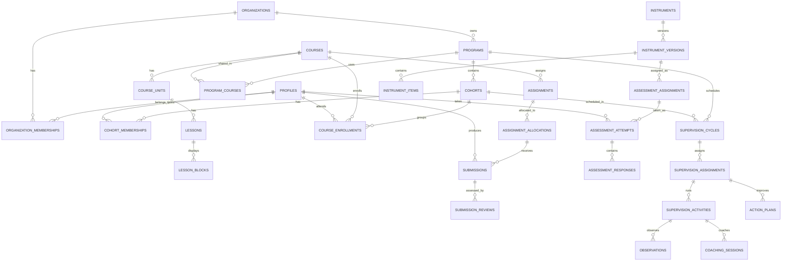

# SolveEdu Integrated Platform
## แผนรวมซอร์สโค้ดและออกแบบฐานข้อมูลใหม่ สำหรับ Claude Code

> **เอกสารฉบับ:** 1.0 — Implementation Blueprint  
> **วันที่จัดทำ:** 2 พฤศจิกายน พ.ศ. 2569 (2026-11-02)  
> **ภาษาเอกสาร:** ไทย; ชื่อตารางและตัวแปร: English / `snake_case`  
> **สถานะ:** ข้อกำหนดเพื่อพัฒนา (Proposed Design) **ไม่ใช่** schema ที่ Deploy แล้ว  
> **เป้าหมาย:** แพลตฟอร์มเดียวสำหรับอบรมพัฒนาครู ประเมินสมรรถนะ นิเทศ ติดตาม Coaching/PLC และวิเคราะห์ข้อมูลวิจัย  
> **ผู้นำไปปฏิบัติ:** Claude Code  
> **ขอบเขตข้อมูล:** ทั้งสอง Repository ยังเป็นระบบทดลอง สามารถเริ่มฐานข้อมูลใหม่ได้ ไม่ต้องย้ายข้อมูลผู้ใช้หรือคะแนนจริง

---

## 0. คำสั่งเริ่มต้นสำหรับ Claude Code (อ่านก่อนลงมือ)

คุณคือ Senior Full-stack Engineer / PostgreSQL–Supabase Architect ผู้รับผิดชอบการรวมระบบนี้ ให้ใช้เอกสารฉบับนี้เป็น **technical source of truth สำหรับเป้าหมายการพัฒนา** และตรวจสอบโค้ดใน Repository ต้นฉบับอีกครั้งก่อนเขียนโค้ด

### Input repositories

1. **ฐานระบบหลัก:** `https://github.com/BabuEiEi/solve-edu-lms.git`
2. **แหล่งฟังก์ชันสร้างบทเรียน:** `https://github.com/BabuEiEi/LMS.git`
3. **ชื่อ Repository เป้าหมายที่เสนอ:** `solve-edu-platform` *(หากยังไม่มี ให้สร้างเป็นโฟลเดอร์โปรเจกต์ใหม่แบบ local; อย่าสร้าง Repository บน GitHub หรือ Push จนได้รับอนุญาต)*

### กฎการปฏิบัติงาน

1. **ห้ามแก้ไข/ลบ/Force-push** สอง Repository ต้นฉบับ; Clone แบบ read-only เพื่ออ้างอิง และทำงานในโฟลเดอร์ใหม่เท่านั้น
2. ตรวจ `git status`, `package.json`, โครงสร้างไฟล์, Schema/RPC ที่เรียกใช้ และ Dependencies จริงก่อนเปลี่ยนแปลง
3. เริ่มจาก Local Supabase และ Migration ที่ตรวจสอบย้อนกลับได้; **ห้าม `db reset --linked` หรือรันคำสั่งทำลายฐานข้อมูล Remote**
4. ห้ามใส่รหัสผ่าน, `service_role`, Supabase Secret Key หรือ OAuth Client Secret ลงในโค้ด Frontend / Git; ใช้ `.env.example` พร้อม Placeholder เท่านั้น
5. ทุกตารางใน Schema ที่เข้าถึงผ่าน Supabase Data API ต้องมี RLS และ GRANT ที่เหมาะสม พร้อม Negative Tests; การซ่อนเมนูใน UI ไม่ใช่ระบบรักษาสิทธิ์
6. ห้ามส่ง **เฉลย / scoring rules / answer keys** ให้ผู้เข้าสอบ; ตรวจคำตอบและให้คะแนนฝั่ง Trusted Backend เท่านั้น
7. เนื้อหาและไฟล์ส่วนตัวของครู/นักเรียน/ผู้นิเทศต้องอยู่ Private Storage และตรวจสิทธิ์ก่อนเข้าถึง
8. เขียนงานทีละ Phase, ทดสอบ Build/Unit/DB/RLS/E2E, สรุปไฟล์ที่แก้และผลทดสอบทุก Phase; หยุดและรายงานหากติดข้อจำกัดที่ต้องมี Credentials
9. ระบบทดลองใหม่สามารถใช้ **Seed Data สมมติ** ได้ แต่ห้ามใช้ข้อมูลบุคคลจริงใน Test หรือ Commit
10. หากการตรวจ Repository ปัจจุบันพบรายละเอียดไม่ตรงกับเอกสาร ให้แจ้งความแตกต่างก่อนตัดสินใจ และยึดความปลอดภัย/ความสมบูรณ์ของข้อมูลเป็นหลัก

### ผลงานที่ต้องส่งมอบเมื่อพัฒนา

- Source code ของโปรเจกต์ใหม่ที่รันได้
- `supabase/migrations/*.sql` พร้อม Seed Data และ RLS policies
- `docs/ERD.md` (Mermaid), `docs/DATA_DICTIONARY.md`, `docs/PERMISSIONS.md`, `docs/API_CONTRACTS.md`
- `.env.example`, `README.md`, คำสั่งติดตั้งและรันทดสอบ
- ชุดทดสอบ Unit, Database/RLS, Integration และ End-to-End
- `docs/MIGRATION_FROM_LEGACY.md` อธิบายว่าอะไรนำจากแต่ละ Repository มาใช้/ปรับปรุง/ไม่ใช้
- รายงานสรุปผล Build/Test และสิ่งที่ยังไม่ได้ทำ

---

## 1. ภูมิหลังและเป้าหมายทางการศึกษา

### 1.1 เป้าหมายหลัก

พัฒนาระบบ **SolveEdu Integrated Platform** ให้เชื่อมโยงกิจกรรมต่อไปนี้ได้ด้วยบัญชีผู้ใช้งานและฐานข้อมูลกลาง:

1. วิเคราะห์สภาพปัจจุบันและความต้องการจำเป็นของครู (Need Assessment)
2. อบรมแบบ On-demand / Online / On-site หลายหลักสูตร หลายรุ่น
3. ประเมินความรู้ก่อน–หลังและสมรรถนะครู เช่น Assessment for Learning, Active Learning และ PISA Literacy
4. จัดส่งภาระงาน แผนการสอน และหลักฐาน; ตรวจงานด้วย Rubric และให้ Feedback แบบวนซ้ำ
5. นิเทศตามกระบวนการ 6Es, สังเกตชั้นเรียน, Coaching, PLC และบันทึกการสะท้อนคิด
6. ติดตามครูรายบุคคล รายโรงเรียน รายโครงการ และภาพรวมเขตพื้นที่
7. ส่งออกข้อมูลระดับรายการ (item-level) เพื่อวิเคราะห์เชิงสถิติ/วิจัยโดยมีมาตรการคุ้มครองข้อมูล

### 1.2 ข้อจำกัดและขอบเขต

- เป็นระบบทดลองใหม่: **ไม่ต้อง Migration ข้อมูลใช้งานจริง** จาก Google Sheets หรือ Supabase เดิม
- อาจใช้ต้นแบบ UI และอัลกอริทึมบางส่วน แต่ **ไม่คัดลอกโค้ดทั้งไฟล์แล้วต่อกัน**
- เริ่ม MVP จากวงจร **สร้างหลักสูตร → ลงทะเบียน → เรียน → ทำแบบทดสอบ → ส่งงาน → ตรวจงาน → Dashboard**
- โมดูลนิเทศ 6Es เชื่อมต่อด้วย Schema ที่วางไว้ตั้งแต่ต้น แล้วเพิ่มหน้าจอ/ฟังก์ชันใน Phase ถัดไป
- รองรับภาษาไทยและวันที่แสดงผลแบบ พ.ศ. โดยจัดเก็บ Time Zone-aware Timestamp และแปลงแสดงผลเป็น `Asia/Bangkok`
- ใช้งานจากเดสก์ท็อปและโทรศัพท์ได้ (Responsive, accessible)

---

## 2. Audit ผลสำรวจโค้ดเดิม — ตรวจสอบซ้ำก่อนเริ่ม Implement

> สรุปจากการตรวจไฟล์บนสาขา `main` วันที่ 2026-11-02; อาจเปลี่ยนแปลงได้หากมี Commit ใหม่ ให้ Claude Code ยืนยันสภาพจริงอีกครั้ง

| ประเด็น | `solve-edu-lms` | `LMS` | แนวทางใหม่ |
|---|---|---|---|
| Frontend | Vite, Vanilla JavaScript, Tailwind, HTML | HTML + Vanilla JS, Tailwind CDN | ยึด Vite + JS แบบแยกโมดูล |
| Authentication | Supabase Auth + Google OAuth + Email | Username/Password ใน Google Sheets | Supabase Auth เท่านั้น |
| Backend | Supabase Postgres/RPC/Storage และ Apps Script บางส่วน | Google Apps Script (`Code.gs`) | Supabase + Trusted Server Functions |
| ผู้ใช้/บทบาท | `student`, `teacher` (Mentor), `staff`, `admin` | Admin, Student | RBAC + หน่วยงาน/โครงการ/รุ่น |
| หลักสูตร | Course + Video + Material Link | Rich Text Lesson, ลิงก์, ภาพ, ไฟล์ | Course → Unit → Lesson → Content Blocks |
| ข้อสอบ | MCQ, เติมคำ, จับคู่, เรียงลำดับ, วิดีโอควิซ | MCQ พร้อมภาพโจทย์และภาพตัวเลือก | Assessment Engine แยกเครื่องมือ/การมอบหมาย/attempt |
| ภาระงาน | Upload/Review + Feedback | ไม่พบระบบตรวจงาน | นำมาออกแบบใหม่ให้มี version และ rubric |
| รายงาน | Score Matrix / Excel / Mentor Dashboard | คะแนนและอันดับ | Dashboard ตาม Scope + Export แบบกำหนดสิทธิ์ |
| ระบบนิเทศเต็มรูปแบบ | ยังไม่พบตารางวงรอบ-แบบสังเกต/แผนติดตามครบ | ไม่พบ | พัฒนา Supervision Module ใหม่ |

### 2.1 สิ่งที่นำจาก `solve-edu-lms`

- หน้าตาและ Navigation แบบแยกบทบาท (`src/main.js`)
- แนวคิดการอนุมัติผู้ใช้ โปรไฟล์ และ Google OAuth
- Course listing, Video Quiz และ Video Watch Logs
- งานส่งภาระงาน (`course_logs`, `submissions`) และหน้า Mentor Review
- Quiz UI หลายรูปแบบ, Score Matrix, ExcelJS Export และ Dashboard
- รูปแบบ SQL การใช้ RLS และ Audit Logs เป็น **ตัวอย่างให้ศึกษา** (ไม่คัดลอกโดยไม่ตรวจ)

### 2.2 สิ่งที่นำจาก `LMS`

- Rich Text Lesson Authoring
- หน้ารายละเอียดบทเรียน พร้อมแกลเลอรีภาพ ลิงก์ และไฟล์ประกอบ
- Form สำหรับแนบภาพในโจทย์และตัวเลือกข้อสอบ
- รูปแบบหน้า Admin จัดบทเรียนและข้อสอบ
- **ไม่ใช้** ระบบ Login/Plaintext Password/Google Sheets เป็นฐานข้อมูลหลัก
- **ไม่ใช้ CKEditor 4** ในระบบใหม่ เพราะรุ่นทั่วไปสิ้นสุดการสนับสนุนแล้ว ให้เลือก Editor ที่ได้รับการดูแลและตรวจ License

### 2.3 จุดที่ต้องแก้ก่อนปล่อยใช้

| รหัส | ความเสี่ยงจากโค้ดต้นแบบ | Requirement ที่ต้องทำ |
|---|---|---|
| SEC-01 | `LMS/Code.gs` มีบัญชี Admin ตั้งต้นและ password แบบข้อความธรรมดา | ยกเลิกวิธีนี้ทั้งหมด ไม่ย้าย password |
| SEC-02 | Endpoint ของ Apps Script จัดการข้อมูลโดยไม่ได้ตรวจสิทธิ์ในทุกฟังก์ชัน | ทุก Write/Read ตรวจ Auth + Authorization ฝั่ง Backend/RLS |
| SEC-03 | `LMS` ส่ง password ผู้ใช้และเฉลยข้อสอบไปฝั่งหน้าเว็บ | ไม่มี API ส่ง password/answer_key ให้ Trainee |
| SEC-04 | `solve` คำนวณและส่งคะแนนจาก Client (มีโอกาสถูกปรับแต่ง) | ตรวจและบันทึกคะแนนบน Server แบบ Atomic |
| SEC-05 | การบันทึกผลใน `submitQuiz` ไม่ตรวจ `error` จาก Supabase อย่างครบถ้วน | ตรวจ error และ Transaction; แสดง Success หลัง Commit |
| SEC-06 | `getPublicUrl()` กับไฟล์งานที่อาจเป็นข้อมูลส่วนบุคคล | Private Buckets + Authorization + Signed Access |
| SEC-07 | `innerHTML` จากข้อมูลภายนอกหลายจุด | Sanitize HTML, Escape Attribute, หลีกเลี่ยง string inline event |
| SEC-08 | Schema ที่ Commit ไว้ไม่ครอบคลุมทุกตาราง/RPC และ `has_video_quiz` | ใช้ Schema/Migrations ใหม่ที่รวมทุก Dependency |
| SEC-09 | `.env` อยู่ใน Public Repository เดิม | ไม่ copy `.env`; ตรวจค่าที่ Commit ว่ามี Secret หรือไม่ และ Rotate หากพบ |
| SEC-10 | Mentor Dashboard ดึงรายชื่อ/ผลรวมจากภาพรวม | ควบคุมข้อมูลตามโรงเรียน รุ่น ผู้รับมอบหมาย |

**ข้อมูลอ้างอิงโค้ด** — ดู References [R1]–[R9] ตอนท้าย

---

## 3. การตัดสินใจด้านสถาปัตยกรรม (Architecture Decisions)

| ADR | การตัดสินใจ | เหตุผล/เงื่อนไข |
|---|---|---|
| ADR-001 | **Modular Monolith** | เริ่มด้วยแอปเดียว แยก Feature Modules; ยังไม่ต้อง Microservices |
| ADR-002 | **Vite + Vanilla JS (ES Modules)** สำหรับ MVP | ลด Rewrite; ถ้าโครงสร้างโตขึ้นค่อยพิจารณา TypeScript/Framework |
| ADR-003 | **Supabase Postgres** เป็น System of Record | relational constraints, SQL, RLS, Analytics |
| ADR-004 | **Supabase Auth** เป็นแหล่งบัญชีเดียว | OAuth และ Email Login; ไม่สร้าง Password Table |
| ADR-005 | **Private Storage by default** | ไฟล์งาน/หลักฐานนิเทศ/Portfolio ต้องจำกัดสิทธิ์ |
| ADR-006 | **Server-side Scoring** | ป้องกันการแก้ไขคะแนน/เฉลยจาก Browser |
| ADR-007 | **Multi-organization + Program Scope** | คนหนึ่งอยู่หลายหน่วยงาน/มีหลายบทบาทในต่างโครงการได้ |
| ADR-008 | **Versioned Instruments / Attempts / Reviews** | รองรับงานวิจัยและติดตามพัฒนาการอย่างตรวจสอบย้อนหลังได้ |
| ADR-009 | **Supabase CLI SQL migrations + Seed + Tests** | สร้างฐานข้อมูลใหม่ได้ซ้ำและ Review ได้ใน Git |
| ADR-010 | **ไม่ใช้ Google Apps Script เป็น Backend ใหม่** | ลดความซ้ำซ้อน Auth/Data; อนุญาตให้เชื่อม Drive/Forms ในอนาคตเป็น Integration ที่ควบคุมสิทธิ์ |

**ข้อเสนอ:** แยก Environment เป็น Local → Staging → Production; อย่าเชื่อมบัญชี Production ตั้งแต่ต้น

---

## 4. ภาพรวมเชิงโดเมนและความหมาย

```
Organization (เขต/โรงเรียน)
  └── Organization Memberships (สิทธิ์ในหน่วยงาน)
Program (โครงการพัฒนาครู; fiscal_year, owner_org)
  ├── Cohorts (รุ่น/กลุ่ม)
  │    ├── Cohort Memberships (Trainee/Trainer/Mentor)
  │    ├── Course Enrollments
  │    └── Supervision Cycles
  └── Program Courses ──> Courses
                            ├── Units ──> Lessons ──> Lesson Blocks
                            ├── Assignments ──> Submissions ──> Reviews
                            └── Assessments ──> Attempts ──> Responses
Supervision Cycles ──> Assignments ──> Activities (6Es)
                                       ├── Observations / Rubric Ratings
                                       ├── Coaching Sessions
                                       ├── Reflections
                                       └── Action Plans / Updates
```

### 4.1 Business Rules สำคัญ

- `auth.users.id` คือรหัสผู้ใช้ต้นทาง; `profiles.id` เป็น FK/PK อ้างอิงเดียวกัน
- โปรไฟล์บุคคล **ไม่ผูก** โรงเรียนถาวรเป็นความสัมพันธ์หลัก: ใช้ `organization_memberships` เพื่อรองรับย้ายโรงเรียน/หลายบทบาท
- `program` = โครงการ, `course` = หลักสูตร/รายวิชา, `cohort` = รุ่นผู้เข้าร่วม, `lesson` = หน่วยเนื้อหาย่อย, `assessment` = การมอบหมายเครื่องมือวัด
- อนุญาต `course` เดียวอยู่หลาย `program` และหลาย `cohort` โดยใช้ตารางเชื่อม; คะแนนและภาระงานต้องมี Cohort/Enrollment Context เพื่อไม่ปะปน
- `cohort_memberships` ให้ผู้ใช้เป็น Trainee/Trainer/Mentor ในแต่ละ Cohort ได้; **หนึ่งคนอาจมีหลาย Role** ในหลายโครงการ
- ผลการประเมิน/ข้อสอบแต่ละครั้งต้องผูก **snapshot version ของเครื่องมือ** เพื่อไม่ให้แก้ไขข้อสอบแล้วคะแนนเดิมเปลี่ยนความหมาย
- การทำ Pretest 1 ครั้งต้องบังคับฝั่ง Backend + DB อย่าง Atomic; `attempt_limit` เป็น configuration ไม่ใช่เพียงการปิดปุ่ม
- `submitted_at`, `reviewed_at` และวันที่นิเทศ ใช้ `timestamptz`; frontend แสดง `Asia/Bangkok`/พ.ศ.
- `status` สำหรับ workflows ควรใช้ CHECK/ENUM ที่ชัดเจนและมีสถานะ `draft`, `published`, `archived` ตามบริบท

---

## 5. Data Dictionary / Proposed Tables

### 5.1 หลักการกำหนดตาราง

- PK ของ Entity ใช้ `uuid default gen_random_uuid()` ยกเว้น `profiles.id = auth.users.id`
- ตาราง Link ใช้ Composite Unique Key และ FK; ถ้าอ้างอิงจากหลายตาราง ใช้ UUID PK เพิ่มได้
- ใช้ `created_at timestamptz not null default now()`, `updated_at timestamptz` พร้อม Trigger ตามความจำเป็น
- ตั้ง `ON DELETE` ให้ชัดเจน: Personal Content/Assessment Result ต้องระวัง Cascade; นิยม Restrict/Soft Delete หรือ Retention Policy สำหรับข้อมูลหลักฐาน
- ค่า `score` ใช้ `numeric(10,2)` หรือคะแนนที่รองรับทศนิยม; percentage แสดงโดยคำนวณจาก `score/max_score`
- `fiscal_year` = Integer ปี พ.ศ.; `year` ใน Timestamp เป็นปี ค.ศ. ตามระบบฐานข้อมูล
- ใช้คอลัมน์ `version integer not null default 1` และ Immutable Published Version สำหรับเครื่องมือวัด
- `jsonb` ใช้กับ Rich Text Blocks และรูปแบบ Response ต่างชนิด; อย่าเก็บ FK/ข้อมูลเชิงตารางทั้งหมดใน JSON
- เมื่อสร้างจริง ต้องกำหนด NOT NULL, CHECK, FK, Unique, Index ตามตารางเหล่านี้; Data Dictionary เป็นข้อกำหนด ไม่ใช่ SQL สำเร็จรูป

### 5.2 Identity / Organization / Program

| ตาราง | คอลัมน์หลัก (ขั้นต่ำ) | FK/Constraint และหมายเหตุ |
|---|---|---|
| `profiles` | `id uuid PK`, `full_name text`, `display_name text`, `avatar_path text`, `contact_email text`, `status text` | `id → auth.users(id)`; ห้ามเก็บ password; `status ∈ {pending,active,suspended}`; แยกการอนุมัติจาก Auth |
| `organizations` | `id`, `code`, `name`, `org_type`, `parent_id`, `active` | `UNIQUE(org_type,code)`; `parent_id → organizations.id`; `org_type ∈ {district,school,other}`; ป้องกันวนลูป hierarchy |
| `organization_memberships` | `id`, `user_id`, `organization_id`, `org_role`, `started_at`, `ended_at` | FK profile/org; uniqueness สำหรับ membership active; Role เช่น `district_admin`,`supervisor`,`school_admin`,`teacher` |
| `platform_role_assignments` | `id`, `user_id`, `role`, `granted_by`, `granted_at`, `revoked_at` | `role ∈ {platform_admin,platform_support}`; ห้ามให้ผู้สมัคร self-assign |
| `programs` | `id`, `code`, `name`, `description`, `fiscal_year`, `owner_org_id`, `status`, `start_at`, `end_at` | FK organization; `UNIQUE(owner_org_id,code)` |
| `cohorts` | `id`, `program_id`, `code`, `name`, `start_at`, `end_at`, `status` | `UNIQUE(program_id,code)` |
| `cohort_memberships` | `id`, `cohort_id`, `user_id`, `cohort_role`, `status`, `approved_by` | Role เช่น `trainee`,`trainer`,`mentor`,`coordinator`; `UNIQUE(cohort_id,user_id,cohort_role)` |
| `mentor_assignments` | `id`, `cohort_id`, `mentor_id`, `trainee_id`, `assigned_at`, `ended_at` | Mentor/Trainee ต้องเป็นสมาชิก Cohort ที่สอดคล้อง; บังคับด้วย Trusted Service/DB |

**ข้อเสนอ Membership:** ใช้ Role Table แบบ Membership-based ก่อน ไม่ต้องใช้ role เดี่ยวใน `profiles`; หากต้องการสิทธิ์ละเอียด ให้เพิ่ม Permission Matrix ใน Service Layer/DB โดยคำนึงถึง RLS

### 5.3 Learning Management

| ตาราง | คอลัมน์หลัก | ความสัมพันธ์/หมายเหตุ |
|---|---|---|
| `courses` | `id`, `code`, `title`, `summary`, `description`, `duration_minutes`, `status`, `owner_org_id`, `created_by` | `UNIQUE(owner_org_id,code)`; แยก course metadata จากบทเรียน |
| `program_courses` | `program_id`, `course_id`, `display_order` | Composite PK หรือ UNIQUE; M:N |
| `course_units` | `id`, `course_id`, `title`, `description`, `display_order`, `status` | FK `courses`; `UNIQUE(course_id,display_order)` เมื่อจำเป็น |
| `lessons` | `id`, `unit_id`, `title`, `learning_objectives`, `display_order`, `required`, `status` | FK `course_units` |
| `lesson_blocks` | `id`, `lesson_id`, `block_type`, `content_json jsonb`, `display_order` | `block_type ∈ {rich_text,video,image,document,link,embed,quiz_reference}`; Validate JSON ต่อ type |
| `course_enrollments` | `id`, `cohort_id`, `course_id`, `user_id`, `status`, `enrolled_at`, `completed_at` | `UNIQUE(cohort_id,course_id,user_id)`; Course ต้องอยู่ใน Program ของ Cohort |
| `lesson_progress` | `id`, `enrollment_id`, `lesson_id`, `status`, `started_at`, `completed_at`, `progress_percent` | `UNIQUE(enrollment_id,lesson_id)`; ตรวจ lesson อยู่ใน enrolled course |
| `video_questions` | `id`, `lesson_block_id`, `timestamp_seconds`, `instrument_item_id`, `required` | คำถามวิดีโอเชื่อมคลังคำถาม ไม่เก็บเฉลยใน Table นี้ |
| `video_interactions` | `id`, `enrollment_id`, `video_question_id`, `attempt_no`, `is_correct`, `answered_at` | เป็น learning telemetry ไม่ใช่หลักฐานยืนยันว่าเรียนครบโดยสมบูรณ์ |

**ตัวอย่าง `lesson_blocks.content_json`:**

```json
{"type":"video","provider":"youtube","video_id":"EXAMPLE_ID","caption":"บทเรียนที่ 1"}
```

```json
{"type":"rich_text","html":"<p>เนื้อหาบทเรียน</p>"}
```

Rich Text ต้อง Sanitize และกำหนด Allowed Tags/Attributes ก่อนเก็บ/แสดง; ห้าม Trust HTML จากผู้ใช้โดยตรง

### 5.4 Assessment / Need Assessment / Rubrics

| ตาราง | คอลัมน์หลัก | ความสัมพันธ์/หมายเหตุ |
|---|---|---|
| `instruments` | `id`, `code`, `title`, `instrument_type`, `status`, `created_by` | ประเภท `quiz`, `survey`, `needs_assessment`, `rubric`, `observation` |
| `instrument_versions` | `id`, `instrument_id`, `version_no`, `status`, `published_at`, `content_hash` | `UNIQUE(instrument_id,version_no)`; Published ห้ามแก้ in place |
| `instrument_dimensions` | `id`, `instrument_version_id`, `code`, `title`, `display_order` | มิติประเมิน เช่น ด้าน 1–5 |
| `instrument_items` | `id`, `instrument_version_id`, `dimension_id`, `prompt`, `item_type`, `options_json`, `max_score`, `display_order` | ชนิด MCQ/Fill/Matching/Ordering/Likert/Paired/Rubric; **ไม่เก็บ answer key ที่ Client SELECT ได้** |
| `private.instrument_answer_keys` | `item_id`, `answer_json`, `scoring_json` | อยู่ Schema `private` ที่ไม่ Expose; ห้าม GRANT SELECT ให้ `anon`/`authenticated`; FK item |
| `assessment_assignments` | `id`, `instrument_version_id`, `cohort_id`, `course_id`, `purpose`, `open_at`, `close_at`, `attempt_limit`, `passing_percent`, `status` | `purpose ∈ {pretest,posttest,formative,survey,needs_assessment,competency}`; scope ตาม cohort/course |
| `assessment_attempts` | `id`, `assignment_id`, `user_id`, `attempt_no`, `status`, `started_at`, `submitted_at`, `score`, `max_score`, `passed` | `UNIQUE(assignment_id,user_id,attempt_no)`; ระบบ Backend บังคับ limit/เวลา/สมาชิก |
| `assessment_responses` | `id`, `attempt_id`, `item_id`, `response_json`, `awarded_score`, `graded_at`, `graded_by` | `UNIQUE(attempt_id,item_id)`; รองรับ Human Marking และการตรวจอัตโนมัติ |
| `rubric_levels` | `id`, `item_id`, `level_no`, `label`, `description`, `score` | ใช้ item แบบ rubric พร้อมเกณฑ์คะแนน |
| `assessment_audit_logs` | `id`, `attempt_id`, `actor_id`, `action`, `before_json`, `after_json`, `reason`, `created_at` | บันทึกแก้ไข/ยกเลิกคะแนน; เขียนโดย Trusted Backend เท่านั้น |

**การทำ Need Assessment แบบ Dual Response:** `item_type='paired_likert'`, `response_json={"current":2,"desired":5}`; คำนวณ `PNI_modified = (I - D) / D` เมื่อ `D > 0`, และต้องกำหนดแนวทางสำหรับกรณีศูนย์ (หาก scale 1–5 จะไม่มี 0 ตามปกติ) พร้อมแยกค่ารายด้าน/รายข้อ

**สำคัญ:** ควรออกแบบ Reporting/Export ให้ส่งออกแบบ Pseudonymized ได้ เช่น ไม่ส่งชื่อ/อีเมลไปกับชุดข้อมูลวิจัยหากไม่จำเป็น

### 5.5 Assignments / Portfolio / Storage

| ตาราง | คอลัมน์หลัก | ความสัมพันธ์/หมายเหตุ |
|---|---|---|
| `assignments` | `id`, `course_id`, `unit_id`, `title`, `description`, `rubric_instrument_version_id`, `due_at`, `status` | Course/Unit context; อนุญาต `unit_id` nullable |
| `assignment_allocations` | `id`, `assignment_id`, `cohort_id`, `available_at`, `due_at`, `max_attempts` | ช่วงเวลาที่แต่ละ Cohort ใช้ Assignment |
| `submissions` | `id`, `allocation_id`, `user_id`, `attempt_no`, `status`, `submitted_at`, `text_response` | `UNIQUE(allocation_id,user_id,attempt_no)`; เก็บหลายรอบ |
| `submission_reviews` | `id`, `submission_id`, `reviewer_id`, `status`, `score`, `feedback`, `reviewed_at` | รองรับตรวจหลายรอบ/เก็บ Review History |
| `submission_rubric_scores` | `id`, `review_id`, `rubric_item_id`, `rubric_level_id`, `score`, `comment` | คะแนนรายองค์ประกอบ, เชื่อม Rubric version ที่ใช้ |
| `file_assets` | `id`, `owner_id`, `bucket`, `object_path`, `mime_type`, `size_bytes`, `visibility`, `created_at` | เก็บ Storage Path ไม่ใช่ permanent signed URL |
| `submission_files` | `submission_id`, `file_asset_id` | M:N ถ้ามีหลายไฟล์ |
| `portfolio_entries` | `id`, `user_id`, `program_id`, `entry_type`, `title`, `description`, `created_at` | แฟ้มสะสมงานรายบุคคล |
| `portfolio_files` | `portfolio_entry_id`, `file_asset_id` | เชื่อมไฟล์เอกสารหลักฐาน |

### 5.6 Supervision 6Es / Coaching / PLC

| ตาราง | คอลัมน์หลัก | ความสัมพันธ์/หมายเหตุ |
|---|---|---|
| `supervision_cycles` | `id`, `program_id`, `cohort_id`, `cycle_no`, `name`, `start_at`, `end_at`, `status` | `UNIQUE(program_id,cohort_id,cycle_no)` โดยจัดการ null ตามนโยบาย |
| `supervision_assignments` | `id`, `cycle_id`, `supervisor_id`, `teacher_id`, `school_id`, `status` | จำกัด supervisor และ teacher ตามขอบเขตโครงการ/โรงเรียน |
| `supervision_activities` | `id`, `supervision_assignment_id`, `stage`, `mode`, `scheduled_at`, `completed_at`, `status`, `notes` | `stage ∈ {exploring,explaining,execute,empower,evaluation,extending}`; `mode ∈ {onsite,online,ondemand}` |
| `observations` | `id`, `activity_id`, `observer_id`, `observed_at`, `class_level`, `subject`, `summary` | บันทึกเปิดชั้นเรียน/สังเกตการสอน |
| `observation_ratings` | `id`, `observation_id`, `instrument_item_id`, `rubric_level_id`, `score`, `evidence` | ต้องอ้าง Rubric version ที่กำหนดกับ observation |
| `coaching_sessions` | `id`, `activity_id`, `mentor_id`, `teacher_id`, `session_at`, `strengths`, `improvement_areas`, `next_steps` | นัด/สรุป Coaching |
| `plc_sessions` | `id`, `program_id`, `cohort_id`, `facilitator_id`, `session_at`, `topic`, `minutes`, `summary` | กิจกรรม PLC; บันทึกผู้เข้าร่วมแยก |
| `plc_participants` | `plc_session_id`, `user_id`, `participation_role` | Composite Unique |
| `reflection_entries` | `id`, `activity_id`, `author_id`, `reflection_type`, `content`, `created_at` | บันทึกสะท้อนคิด/ถอดบทเรียน/AAR |
| `action_plans` | `id`, `supervision_assignment_id`, `goal`, `owner_id`, `due_at`, `status`, `success_criteria` | แผนปรับปรุงหลังนิเทศ |
| `action_plan_updates` | `id`, `action_plan_id`, `progress_percent`, `narrative`, `updated_by`, `updated_at` | เก็บความก้าวหน้ารายครั้ง |
| `action_plan_evidence` | `action_plan_update_id`, `file_asset_id` | หลักฐานความก้าวหน้า |

**หมายเหตุด้านสมรรถนะครู:** หากต้องมี Pre/Post Competency Rubric แบบเป็นระบบ ให้เก็บคะแนนผ่าน Assessment Engine และอ้าง `assessment_attempts` จากกิจกรรมที่เกี่ยวข้อง แทนการสร้างตารางคะแนนใหม่ซ้ำ

---

## 6. ER Diagram (Conceptual — Mermaid)



> เป็น ERD ในระดับ Conceptual; ให้ Claude Code สร้าง ERD เชิง Physical ใหม่ภายหลังเขียน Migration จริง และตรวจ FK/Nullability/Uniqueness ด้วยเครื่องมือ Postgres

---

## 7. Authorization Model / RLS / Data Boundaries

### 7.1 Role Matrix

| Actor / Role | อ่าน/แก้โปรไฟล์ | บริหารหลักสูตร | ทำ/ตรวจแบบทดสอบ | ส่ง/ตรวจงาน | ข้อมูลนิเทศและ Dashboard |
|---|---|---|---|---|---|
| Visitor / `anon` | ไม่เห็นข้อมูลส่วนตัว | เห็นเฉพาะหน้าประชาสัมพันธ์ที่ Publish | ไม่ได้ | ไม่ได้ | ไม่ได้ |
| Trainee | ของตนเอง | อ่านหลักสูตรที่ลงทะเบียน | ทำของตนเอง/ดูผลตามนโยบาย | ส่งของตนเอง | เห็นเฉพาะผลและ Feedback ของตน |
| Trainer | ของตน/ผู้เข้าร่วมในรุ่นตามความจำเป็น | จัดเนื้อหาเฉพาะที่มอบหมาย | สร้างเครื่องมือ/ดูคะแนนรุ่นที่ดูแล | ตรวจงานที่รับผิดชอบ | ดูสรุปเฉพาะรุ่นที่ได้รับสิทธิ์ |
| Mentor | ของตน/ครูที่มอบหมาย | อ่านเนื้อหาในขอบเขตงาน | ดูความก้าวหน้าครูที่รับผิดชอบ | ตรวจงานครูที่มอบหมาย | บันทึกนิเทศ/Coaching เฉพาะผู้รับมอบหมาย |
| School Admin | ครูในโรงเรียนที่ตนรับผิดชอบ | ดูที่เปิดให้โรงเรียน | ดูข้อมูลสรุปโรงเรียน | ดูสถานะงานตามสิทธิ์ | ดูรายงานเฉพาะโรงเรียน |
| District Supervisor/Admin | ตามเขตพื้นที่และโครงการ | จัดการโครงการที่ได้รับสิทธิ์ | ดูรายงานระดับเขตตามสิทธิ์ | มอบหมาย/ดูงานในเขต | วางแผนและติดตามนิเทศตาม Scope |
| Platform Admin | ข้อมูลการดูแลระบบตามหลักจำเป็น | บริหารระบบ | ไม่เห็นเฉลยโดยอัตโนมัติ เว้นสิทธิ์พิเศษ | ดูตามเหตุจำเป็น | Audit/Configuration |

**อย่าปะปน** Platform Admin (ดูแลระบบ) กับ District Admin (ดูแลข้อมูลเขต) และ Trainer/Mentor (บทบาทในโครงการ)

### 7.2 Policy Rules (ต้อง Implement จริง)

1. `profiles`: ผู้ใช้ SELECT/UPDATE เฉพาะข้อมูลของตน (คอลัมน์ที่ไม่ใช่สิทธิ์); Admin เห็นข้อมูลตาม Scope; ห้ามผู้ใช้ UPDATE `status`, `role` หรือ membership เอง
2. `organization_memberships`: อ่านเฉพาะ membership ที่เกี่ยวข้อง/มีสิทธิ์บริหาร; Grant/Revoke ผ่าน Trusted Function ที่ตรวจผู้สั่งและบันทึก Log
3. `cohort_memberships`: ผู้เข้าร่วมเห็นสิทธิ์ตนเอง; Mentor/Trainer เห็นเท่าที่จำเป็น; ไม่ expose Email/PII ของผู้อื่นเกินจำเป็น
4. `courses`, `lessons`: เฉพาะ published + enrolled หรือ Admin/Trainer ตาม Scope; Draft ไม่เผยแพร่
5. `assessment_attempts/responses`: เจ้าของอ่านของตัวเอง; ห้าม Client UPDATE score/graded_at; Reviewer เข้าถึงเฉพาะ Assignment ที่รับผิดชอบ
6. `private.instrument_answer_keys`: ห้าม Client SELECT โดยเด็ดขาด; Backend Scoring ที่ได้รับอนุญาตเท่านั้น
7. `submissions`: ผู้ส่งอ่าน/แก้ Draft ของตน; เมื่อ Submitted ต้องสร้าง New Attempt ไม่ overwrite; Mentor อ่าน/ตรวจเฉพาะ Assignment ที่รับผิดชอบ
8. `supervision_*`: จำกัดตาม `supervision_assignments`, School Scope, Program Scope; ห้ามครูอ่านหลักฐานหรือบันทึกของครูคนอื่น
9. `file_assets` และ `storage.objects`: Bucket Private + Path ถูกผูกกับ Owner/Resource/Scope; คำขอ Signed URL ต้องตรวจสิทธิ์ก่อนเสมอ
10. คะแนน/ผลการประเมินที่แก้ไขโดย Admin หรือ Reviewer ต้องมี Audit Trail (ผู้แก้ วันเวลา ค่าเดิม ค่าใหม่ และเหตุผล)

### 7.3 Server-side Scoring — Mandatory Design

**ห้าม** โหลดข้อสอบด้วย `select('*')` หาก Table/Response มีเฉลย และห้ามให้ Browser ส่ง `score`, `passed`, `graded_at` เป็นค่าที่เชื่อถือได้

**Trusted workflow:**

```text
Browser (JWT + assignment_id + answers)
    -> Validated Endpoint / Authorized RPC
        -> Verify authenticated actor + cohort eligibility
        -> Verify published instrument version and time window
        -> Enforce attempt limit atomically (unique + transaction/lock)
        -> Load private answer keys
        -> Score / Validate all item responses
        -> Insert attempt and item responses in ONE transaction
        -> Return result according to release policy
        -> Append audit log where relevant
```

ให้ Claude Code เลือก Implementation ที่ปลอดภัยโดยตรวจเอกสาร Supabase ปัจจุบัน: Edge Function สำหรับ entry point ที่ตรวจ JWT และ authZ ร่วมกับ Database Transaction/RPC ที่ `EXECUTE` ถูกจำกัด หรือ backend ที่เชื่อม Postgres แบบ Trusted; หลีกเลี่ยง `SECURITY DEFINER` ใน Exposed Schema โดยไม่จำเป็น และถ้าจำเป็นต้องใช้ ให้มี Explicit `auth.uid()` verification, `search_path` ที่ปลอดภัย, `REVOKE EXECUTE FROM PUBLIC` และ Negative Tests

### 7.4 Policy Test Matrix (ขั้นต่ำ)

| Scenario | Expected |
|---|---|
| Anonymous อ่านข้อมูลอีเมล/คะแนนครู | DENY |
| Trainee A อ่านคะแนน/ไฟล์ของ Trainee B | DENY |
| Trainee แก้ role/status หรือให้คะแนนตนเอง | DENY |
| Mentor A อ่านงานของครูนอกกลุ่มที่รับผิดชอบ | DENY |
| School Admin A อ่านข้อมูลโรงเรียน B | DENY |
| Trainer อ่านเฉลยได้จาก Public API | DENY |
| Trainee submit Pretest ซ้ำเกิน limit พร้อมกันสองคำขอ | ONE SUCCESS ONLY |
| ผู้ผ่านสิทธิ์ดูคะแนน/ไฟล์/บทเรียนของตน | ALLOW |
| Admin แก้คะแนนที่ได้รับอนุญาต | ALLOW + AUDIT |
| บุคคลที่ถูกถอนสิทธิ์เข้าถึงใหม่ | DENY หลัง permission revocation ตาม design |

---

## 8. โครงสร้างซอร์สโค้ดใหม่

```text
solve-edu-platform/
├── README.md
├── CLAUDE.md                       # คำสั่งย่อและลิงก์มายังเอกสารนี้
├── .env.example                    # Placeholder เท่านั้น
├── .gitignore
├── package.json
├── package-lock.json
├── index.html
├── src/
│   ├── main.js
│   ├── core/
│   │   ├── supabaseClient.js
│   │   ├── auth.js
│   │   ├── permissions.js
│   │   ├── router.js
│   │   └── errors.js
│   ├── features/
│   │   ├── profiles/
│   │   ├── organizations/
│   │   ├── programs/
│   │   ├── courses/
│   │   ├── lessons/
│   │   ├── assessments/
│   │   ├── assignments/
│   │   ├── portfolio/
│   │   ├── supervision/
│   │   └── analytics/
│   ├── shared/
│   │   ├── ui/
│   │   ├── services/
│   │   ├── validators/
│   │   ├── utils/
│   │   └── i18n/
│   └── styles/
├── supabase/
│   ├── config.toml
│   ├── migrations/                 # SQL migration ตามลำดับที่สร้างจริง
│   ├── functions/                  # Trusted API/Scoring หากใช้ Edge Functions
│   ├── tests/                      # pgTAP / RLS tests
│   └── seed.sql
├── tests/
│   ├── unit/
│   ├── integration/
│   └── e2e/
├── docs/
│   ├── ARCHITECTURE.md
│   ├── ERD.md
│   ├── DATA_DICTIONARY.md
│   ├── PERMISSIONS.md
│   ├── API_CONTRACTS.md
│   └── MIGRATION_FROM_LEGACY.md
└── scripts/
```

### Code migration map

| จากโค้ดเดิม | ไปยัง Feature ใหม่ | หมายเหตุ |
|---|---|---|
| `solve/src/main.js` ส่วน Auth + Approval | `core/auth`, `features/profiles` | แยก Auth จาก UI และ Authorization |
| `solve/src/main.js` Course CRUD | `features/courses` | เปลี่ยนเป็น Program/Course/Unit/Lesson |
| `LMS/index.html` Rich Text + Lesson Gallery | `features/lessons` | Rewrite DOM/Editor และ Storage Integration |
| `LMS/Code.gs` `fetchLessonList`/`saveLesson` | ไม่ย้าย Backend | ออกแบบ API/DB ใหม่แทน |
| `LMS` Quiz Image UI | `features/assessments` | ใช้ Private/Public Media ตามประเภท |
| `solve` Quiz/Video Question UI | `features/assessments` | แยก Presentation / Trusted Scoring |
| `solve` Upload Work / Mentor Review | `features/assignments` | มี Submission Attempts + Rubric |
| `solve` Score Matrix/Excel | `features/analytics` | Report ข้อมูลตาม Scope และ Pseudonymize |
| — | `features/supervision` | พัฒนาใหม่ตาม 6Es |

---

## 9. UI / UX Modules และ User Journeys

### 9.1 Dashboard ตามบทบาท

- **Trainee:** บทเรียนที่ลงทะเบียน ความคืบหน้า Pre/Post คะแนน ภาระงาน Feedback ประวัติการอบรม และ Portfolio
- **Trainer:** Course Builder จัดเนื้อหา สร้างแบบทดสอบ/มอบหมายกิจกรรม จัดการงานที่ต้องตรวจ
- **Mentor:** รายชื่อครูรับผิดชอบ งานที่รอตรวจ Coaching/นิเทศ Calendar และผลสมรรถนะก่อน–หลัง
- **School Admin:** สรุปครูโรงเรียนตนเอง อัตราเข้าอบรม ผ่านเกณฑ์ และสถานะภาระงาน
- **District Admin/Supervisor:** มุมมองหลายโรงเรียน Dashboard เป้าหมาย/ผลจริง วงรอบนิเทศ/รายงาน
- **Platform Admin:** ระบบผู้ใช้ องค์กร สิทธิ์ และ Audit

### 9.2 User Journey: การอบรม

1. District Admin สร้าง Program (`fiscal_year=2570`) / Cohort
2. Trainer สร้าง Course → Units → Lessons → Blocks (Video/Rich Text/Docs)
3. Admin ลงทะเบียน Trainee ใน Cohort + Course
4. Trainee ทำ Pretest โดยมี Attempt Limit ตาม Assignment
5. Trainee เรียน ส่งภาระงาน รับ Feedback แก้งานตามเกณฑ์
6. Trainee ทำ Posttest และแบบประเมินความพึงพอใจ
7. Mentor/Trainer ตรวจผล; Dashboard สรุปความก้าวหน้าและผลคะแนน

### 9.3 User Journey: นิเทศ 6Es

1. **Exploring:** Need Assessment / ผลก่อนพัฒนา / ข้อมูลพื้นฐาน
2. **Explaining:** หลักสูตรและเนื้อหาพัฒนาความเข้าใจ
3. **Execute:** ออกแบบ/ปฏิบัติ/ส่งแผนและหลักฐาน
4. **Empower:** Mentoring, Coaching และ PLC
5. **Evaluation:** Rubric, Posttest, Observation, Feedback
6. **Extending:** แผนปรับปรุง การนำไปใช้จริง และนิเทศติดตามหลายรอบ

บันทึกการนิเทศต้องเชื่อม Program, Cohort, Teacher, Supervisor และ Cycle เพื่อเปรียบเทียบหลายรอบโดยไม่ซ้ำซ้อน

---

## 10. Roadmap / Phases / Definition of Done

### Phase 0 — Preflight & Repository Audit

**Actions**
- Clone สองโครงการเป็น read-only reference
- ตรวจ package, JavaScript, GAS, Supabase SQL, External Dependencies, Licensing
- สร้าง Inventory ฟังก์ชัน/ตาราง/RPC และ Risk Register
- สรุป Changes ที่จะย้าย/Rewrite/Drop เป็น `docs/MIGRATION_FROM_LEGACY.md`

**DoD**
- มี audit report ที่เชื่อมชื่อฟังก์ชันจริงกับโมดูลเป้าหมาย
- ไม่มี secret ถูกนำมา Commit ในโปรเจกต์ใหม่

### Phase 1 — Foundation, Schema, Auth & RLS

**Actions**
- ตั้ง Vite Project, Supabase Local, `.env.example`, ESLint/Formatter/Test Runner
- สร้าง SQL สำหรับ Identity/Organization/Program/Cohort/Role Membership
- สร้าง Core Course/Unit/Lesson และ Seed Data จำลอง
- กำหนด RLS/GRANT และทดสอบ Negative Cases
- สมัคร/เข้าสู่ระบบด้วย Email/Google (Google OAuth ทำหลังมีค่า Credentials)

**DoD**
- `npm run build` ผ่าน; `supabase db reset` Local ผ่าน
- Account → Profile เกิดได้ปลอดภัย; แก้ Role/Status ด้วยตนเองไม่ได้
- Admin เห็นเฉพาะ Scope ที่ได้รับสิทธิ์
- RLS allow/deny tests ผ่าน

### Phase 2 — Integrated LMS

**Actions**
- Course Builder, Unit/Block Editor และ Media Storage
- Rich Text Editor รุ่นที่ support; sanitize HTML
- Enrollment / Lesson Progress / Video/Material
- Pre/Post Quiz MVP (อย่างน้อย MCQ + รูปภาพโจทย์/ตัวเลือก)
- Trusted Scoring และ Versioned Instrument

**DoD**
- สร้าง Course ≥2 Units, ≥2 Lessons/Unit ได้
- Trainee ที่ลงทะเบียนเรียนและบันทึก Progress ได้
- Pretest Attempt Limit ทำงานแม้ส่งคำขอซ้ำ/พร้อมกัน
- ไม่มี Answer Keys ใน API Response ของ Trainee

### Phase 3 — Assignments, Rubric, Needs Assessment, Portfolio

**Actions**
- Upload งานหลายไฟล์, Review/Feedback, ส่งงานใหม่แบบ versioned attempts
- Rubric Criterion + คะแนนรายด้าน
- Dual-response Need Assessment, Likert Satisfaction, CSV/Excel Export
- Basic Portfolio

**DoD**
- Trainee ส่งงาน→Mentor ตรวจ→Trainee แก้ไข/ส่งรอบใหม่ ได้พร้อม History
- PNI Modified รายข้อ/รายด้านถูกต้องโดยมี Unit Test
- Export ไม่รั่วข้าม Scope

### Phase 4 — Supervision 6Es

**Actions**
- Supervision Cycles + Assignments + Calendar
- Observation/Rubric; Coaching; PLC; Reflection; Action Plans
- ติดตามหลายรอบและสร้างหลักฐานเชื่อมกับ Portfolio

**DoD**
- Demo ครู 2 คน/โรงเรียน 2 แห่ง/ผู้นิเทศต่างกัน
- Supervisor A เข้าถึงเฉพาะผู้ได้รับมอบหมาย และบันทึก 6Es ได้
- Timeline พัฒนาการและ Action Plan ถูกต้อง

### Phase 5 — Analytics, Research, Hardening & Pilot

**Actions**
- Dashboard ระดับบุคคล/โรงเรียน/เขต/โครงการ
- เป้าหมาย vs ผลจริง แยกชัดเจน; รายงาน PA/Project Progress
- Item-level / Pseudonymized CSV สำหรับ SPSS และ Excel Summary
- Test Performance/Accessibility/Backup/Restore และ Pilot โรงเรียนจำนวนน้อย

**DoD**
- Acceptance checklist ทุกบทบาทผ่าน
- Backup/Restore ทดลองผ่าน
- ไม่มี Critical/High unresolved security findings ก่อนใช้ข้อมูลจริง

### Priorities

- **P0:** Auth, Secure Roles/RLS, Data Model, Server-side Scoring, Safe Storage
- **P1:** Course/Unit/Lesson, Enrollment, Pre/Post, Assignment/Review, Core Dashboards
- **P2:** Needs Assessment, Rubric, Portfolio, Video Quiz, 6Es, PLC
- **P3:** Advanced Analytics, Publication/Certificates, Integration, AI Assistant

---

## 11. MVP Acceptance Tests (End-to-End)

- [ ] สมัครสมาชิกใหม่แล้วได้ `profiles` ที่ไม่สามารถตั้ง platform admin role ให้ตนเอง
- [ ] Admin สร้าง Program → Cohort → Course → Unit → Lesson พร้อม Publish
- [ ] Trainee ลงทะเบียนและเรียนบทเรียนได้ ข้อมูล Progress ตรง Enrollment
- [ ] Trainee ทำ Pretest 1 ครั้ง และส่งพร้อมกัน 2 Request แล้วไม่เกิด 2 Successful Attempts
- [ ] เฉลย/คะแนนที่ตรวจโดย Server ไม่สามารถแก้จาก DevTools แล้วบันทึกคะแนนปลอมได้
- [ ] ข้อสอบ MCQ รองรับรูปภาพโจทย์/ตัวเลือก; ตรวจและให้คะแนนถูกต้อง
- [ ] Trainee ส่งงานและไฟล์แนบ; Mentor เฉพาะผู้ได้รับมอบหมายตรวจได้
- [ ] Feedback + Submission Attempt รอบที่ 2 ไม่ทับ History รอบที่ 1
- [ ] Trainee A เปิด URL/ไฟล์/คะแนนของ Trainee B ไม่ได้
- [ ] School Admin A อ่านข้อมูลโรงเรียน B ไม่ได้
- [ ] Export CSV/Excel ส่งออกข้อมูลได้ตาม Scope และรองรับ Pseudonymized
- [ ] สร้างกิจกรรม 6Es และเก็บหลักฐานสังเกต/Coaching ได้
- [ ] แสดงเวลาไทยและปี พ.ศ. โดย Database เก็บ `timestamptz`
- [ ] `npm run build`, lint, unit tests, DB tests และ E2E MVP ผ่าน
- [ ] Clone โปรเจกต์ใหม่ + Run Local จาก Migration/Seed ได้ครบ โดยไม่ต้องเข้าฐานข้อมูลเดิม

---

## 12. ตัวอย่าง SQL Design Patterns (เพื่อชี้แนวทาง ไม่ใช่ Migration สำเร็จรูป)

### 12.1 Profile โดยไม่เก็บ Password

```sql
create table public.profiles (
  id uuid primary key references auth.users(id) on delete cascade,
  full_name text not null default '',
  display_name text,
  avatar_path text,
  contact_email text,
  status text not null default 'pending'
    check (status in ('pending', 'active', 'suspended')),
  created_at timestamptz not null default now(),
  updated_at timestamptz not null default now()
);

alter table public.profiles enable row level security;

-- Example READ policy only; DO NOT grant unguarded UPDATE on role/status.
create policy "read own profile"
  on public.profiles for select to authenticated
  using (id = (select auth.uid()));
```

**Claude Code ต้องต่อเติม:** คำสั่ง GRANT ที่พอดี, Trigger/Identity lifecycle ที่ทดสอบแล้ว, Column-level privileges/Trusted RPC สำหรับเปลี่ยน status, และ RLS ของผู้ดูแลตาม Scope ให้ครบ **ก่อนใช้งานจริง** ตัวอย่างนี้ไม่ครอบคลุมทุก Policy

### 12.2 จำกัดการทำข้อสอบซ้ำระดับฐานข้อมูล

```sql
-- Proposed invariant: prevent duplicate same-number attempts.
create unique index if not exists uq_assessment_attempt_identity
  on public.assessment_attempts (assignment_id, user_id, attempt_no);
```

แค่ Unique Index ไม่เพียงพอจะบังคับ `attempt_limit` เมื่อคำขอเข้าพร้อมกัน ต้องสร้าง Transaction/Lock บน `(assignment_id,user_id)` และตรวจสิทธิ์/ช่วงเวลาภายใน Trusted Backend ก่อน Commit

### 12.3 ดัชนีสำคัญ

- `organization_memberships(user_id, organization_id)` และ `(organization_id, user_id)` ตาม Query
- `cohort_memberships(user_id, cohort_id)` และ `(cohort_id, user_id)`
- `course_enrollments(user_id, cohort_id)`
- `assessment_attempts(assignment_id, user_id)`
- `submissions(allocation_id, user_id, submitted_at)`
- `supervision_assignments(supervisor_id, teacher_id, cycle_id)`
- ดัชนีของ FK/คอลัมน์ที่ RLS ใช้ WHERE/JOIN ทุกจุดที่จำเป็น

**คำเตือน:** อย่าใช้ `SECURITY DEFINER` เพื่อแก้ปัญหา RLS ล้มเหลวโดยไม่วิเคราะห์ความเสี่ยง; DB Function ที่ได้รับสิทธิ์สูงต้องกำหนดเจ้าของ, grant/revoke และ test สถานการณ์ไม่อนุญาต

---

## 13. การพัฒนาและเครื่องมือ (Developer Workflow)

### 13.1 เตรียม Local Environment

```bash
# ในโปรเจกต์ใหม่ (ตรวจ prerequisites ก่อน: Node, npm, Docker-compatible runtime)
npm install
npm install supabase --save-dev
npx supabase init
npx supabase start
```

> คำสั่งสำหรับ Local เท่านั้น; ถ้าโปรเจกต์ใหม่ยังไม่สร้างให้ Claude Code scaffold Vite ก่อน ใช้ CLI help ตรวจวิธีสร้าง Migration ในเวอร์ชันที่ติดตั้งจริง

### 13.2 Migration / Seed / Verify

```bash
# ตัวอย่างการสร้าง migration ตามคำสั่ง CLI ปัจจุบัน
npx supabase migration new foundation_identity_organizations
npx supabase migration new programs_and_courses
npx supabase migration new assessments_and_submissions
npx supabase migration new supervision_core
npx supabase migration new rls_and_storage_policies

# ทดสอบ LOCAL ONLY: ลบและสร้างฐานข้อมูล Local จาก migrations + seed
npx supabase db reset --local

# ทดสอบ DB / RLS หลังสร้าง tests แล้ว
npx supabase test db

# ทดสอบ frontend
npm run build
```

**คำสั่งจริงให้ปรับตาม CLI เวอร์ชัน ณ วันปฏิบัติ และแยก migrations ตาม dependency จริง** ไม่ต้องสร้างไฟล์ว่างจำนวนมากโดยยังไม่ได้เขียน SQL

### 13.3 Environment / Secret Management

`.env.example` (ตัวอย่าง):

```dotenv
VITE_SUPABASE_URL=https://YOUR_PROJECT.supabase.co
VITE_SUPABASE_PUBLISHABLE_KEY=YOUR_PUBLIC_PUBLISHABLE_KEY
```

- ถ้า SDK/โปรเจกต์ใช้ชื่อ Env อื่น ให้คงความสอดคล้องระหว่าง `supabaseClient.js` กับ `.env.example`
- Publishable/Legacy Anon Key สำหรับ Browser ใช้ได้ภายใต้ RLS ที่เข้มงวด; **Service/Secret Key ห้ามอยู่ใน `VITE_*`**
- OAuth Client Secret, SMTP Keys, Server Secrets ต้องเก็บใน Secret Manager/Server environment
- `.env*` จริง ต้องอยู่ใน `.gitignore` ยกเว้น `.env.example`
- เพิ่ม CI ตรวจ dependency vulnerability และ secret scanning

---

## 14. ข้อกำหนดด้านคุณภาพและความปลอดภัย

**Security**
- Authentication ทุก API ที่ไม่ใช่ Public Content
- Authorization ต้องตรวจ Role + Organization/Program/Cohort/Mentor Scope
- RLS ทุกตารางที่ Exposed; `private` schema ไม่ Expose, จำกัด Grant
- ห้าม User-settable Claim/Metadata ใช้เป็นแหล่งยืนยันบทบาทของตนเอง
- ห้าม Return Password, Answer Key, Secret Key หรือ Storage Permanent Public URL สำหรับข้อมูลส่วนตัว
- Rich Text Sanitization, URL/Upload validation, Rate Limiting, Input Validation และ CSP
- Guard concurrent submission, replay attack และ unauthorized grading
- Audit Trails สำหรับ Grade/Role/Permission Changes
- Retention/Deletion Policy และสำรอง/กู้คืนข้อมูล

**Quality**
- แยก UI Rendering / Data Service / Domain Logic
- หลีกเลี่ยง `src/main.js` ไฟล์ยักษ์; ชื่อฟังก์ชัน/ไฟล์สื่อความหมาย
- ป้องกัน XSS จากการประกอบ HTML strings ด้วย interpolation
- รายงานข้อผิดพลาดให้ผู้ใช้เข้าใจ พร้อม Log ให้ developer ตรวจสอบ (ไม่เผย secret)
- Responsive และ Keyboard Navigation/Accessible Form Labels
- Testability: Mocked Unit + Local DB Integration + Role-based E2E
- Data Quality: FK/Unique/Check/Cascade/Indexes/Versioning ตรงตาม Business Rules

**Research / Measurement Quality**
- แยก `target` จาก `actual` ใน Dashboard
- เก็บตอบรายข้อและ Version ของเครื่องมือ
- แบบสอบถามตอบสนองคู่ต้องมี Current/Desired แยกกัน
- ค่าตัดสินผ่านเกณฑ์เป็น Configuration รายเครื่องมือ/หลักสูตร ไม่ Hardcode ร้อยละ 80
- ส่งออกข้อมูล Research แบบ Pseudonymized พร้อม Codebook/Metadata และ Time of Export
- บันทึกว่าเครื่องมือใดใช้กับกลุ่มใด เมื่อใด ใครประเมิน และประเมินรอบไหน

---

## 15. ข้อเสนอ Design ของ Dashboard

| ระดับ | KPI หลัก | ข้อควรระวัง |
|---|---|---|
| รายบุคคล | ความก้าวหน้ารายบทเรียน Pre/Post รายด้าน งานที่ส่ง การตรวจและ Coaching | เจ้าของเห็นเฉพาะของตนและ Feedback ที่ Release แล้ว |
| โรงเรียน | จำนวนครูที่ลงทะเบียน/เข้าเรียน/ผ่านเกณฑ์ งานค้าง/งานผ่าน ความก้าวหน้าการนิเทศ | ต้องกรอง School Scope และระวังการระบุตัวบุคคลจากกลุ่มเล็ก |
| โครงการ/รุ่น | Enrollment, Completion, Mean Score, Change Score, Satisfaction, Needs | แยก Target และ Actual และระบุ N ของแต่ละตัวชี้วัด |
| เขตพื้นที่ | Coverage โรงเรียน/ครู คณะนิเทศ วงรอบ ผลประเมินสมรรถนะ และความก้าวหน้า | ใช้เฉพาะขอบเขตที่ได้รับอนุญาต |
| Research | Dataset รายข้อ, Rubric Dimensions, Paired Responses, Before–After | Export แบบ Pseudonymized; มี Data Dictionary และ Consent/Policy |

**ตัวอย่างเป้าหมายเชิงการศึกษา:** ครูร้อยละ 80 ผ่านเกณฑ์สมรรถนะตามที่กำหนดในโครงการ; เป็น **เป้าหมาย** ไม่ควรแสดงเป็นผลสำเร็จหากไม่มีข้อมูลยืนยัน

---

## 16. ความเสี่ยง / Trade-offs / สิ่งที่ต้องตัดสินใจในระยะพัฒนา

| Risk / Decision | ผลกระทบ | แนวทางจัดการ |
|---|---|---|
| Schema ใหญ่ตั้งแต่ต้น | อาจทำให้ MVP ช้า | วาง Conceptual Schema ครบ แต่ Implement เฉพาะ Core Tables ตาม Phase |
| Editor ภายนอก | License, XSS, บำรุงรักษา | เลือก Editor รุ่นที่มี Support / ตกลง License / Sanitize เนื้อหา |
| การทำข้อสอบด้วย Browser | ปลอมผลคะแนน | Server-side scoring และตรวจสิทธิ์ตาม Instrument Version |
| RLS ตามหลาย Role/หลาย Scope | Policy ซับซ้อน/อาจ Recursion | Test Policy ตาม Scenario; ใช้ Helper Function จำกัดสิทธิ์อย่างรอบคอบ |
| Storage Access | ไฟล์ส่วนบุคคลรั่ว | Private Bucket, authorize Signed Access |
| หลักสูตรใช้ซ้ำหลายรุ่น | การแก้บทเรียนทำให้ผลย้อนหลังเปลี่ยน | Versioning Course Content เมื่อ Publish/มี Attempts |
| User สังกัดหลายโรงเรียน/หลายโครงการ | ข้อมูลสลับ Scope | Membership Table + Current Context Selector |
| ข้อมูลวิจัย | PII และความเที่ยงของข้อมูล | Data Governance, Codebook, Immutable Attempts, Audit |
| Video Learning Evidence | ข้อมูล Player อาจปลอมได้ | ใช้เป็น Telemetry และ Cross-check กับกิจกรรม/Quiz ไม่ใช่หลักฐานเด็ดขาด |
| ขยายงานจาก LMS เป็น Supervision | Scope creep | Phase-based delivery และ MVP DoD |

---

## 17. ลำดับคำสั่งงานสำหรับ Claude Code (Execution Checklist)

### Sprint A — Audit + Foundation

- [ ] Clone/inspect ทั้งสอง Repository โดยไม่เปลี่ยนต้นฉบับ
- [ ] สร้าง Target Directory พร้อม Vite, lint/test tools และ README
- [ ] สร้าง `docs/ARCHITECTURE.md` และ `docs/MIGRATION_FROM_LEGACY.md`
- [ ] ออกแบบ Physical ERD และสร้าง SQL Migration ชุด Core
- [ ] เพิ่ม RLS/GRANT และ DB Tests
- [ ] Seed Users/Organizations/Programs/Courses แบบสมมติ
- [ ] Build + Local DB reset + Policy tests ผ่าน

### Sprint B — LMS MVP

- [ ] Course/Unit/Lesson Editor ที่ใช้ได้จริง
- [ ] Image/Document/Video blocks พร้อม Content Sanitization
- [ ] Enrollment + Lesson Progress
- [ ] Assessment version + Server-side MCQ Scoring
- [ ] Submission + Mentor Review / Feedback
- [ ] UI/Service Tests + E2E ครบวงจร

### Sprint C — Development/Research/Supervision

- [ ] Need Assessment + Paired Response, Rubric และ Portfolio
- [ ] Supervision Cycles, Observations, Coaching, PLC, Action Plans
- [ ] Dashboard แบบ Scope-aware + Export + Codebook
- [ ] Performance/Security/Accessibility Review และคู่มือใช้งาน

### รูปแบบการตอบกลับที่ต้องการจาก Claude Code ในแต่ละรอบ

1. สรุปความเปลี่ยนแปลงเป็นภาษาไทย
2. รายชื่อไฟล์ที่สร้าง/แก้ไข
3. คำสั่งที่รันจริงและผล Test (PASS/FAIL/SKIP พร้อมเหตุผล)
4. รายการสิ่งที่ยังไม่ทำ/ความเสี่ยง
5. ขั้นตอนที่ควรทำต่อ และคำสั่ง Run สำหรับผู้ใช้

---

## 18. แหล่งอ้างอิง (References)

### A. Source Code / Repository ต้นฉบับ (หลักฐานจากโค้ดที่ตรวจ)

- **[R1]** BabuEiEi. *solve-edu-lms* (GitHub Repository, main). https://github.com/BabuEiEi/solve-edu-lms
- **[R2]** BabuEiEi. *solve-edu-lms — package.json* (Vite, Supabase JS, ExcelJS, Tailwind). https://github.com/BabuEiEi/solve-edu-lms/blob/main/package.json
- **[R3]** BabuEiEi. *solve-edu-lms — src/main.js* (Auth, Quiz, Submission, Mentor Dashboard, Video Questions, Score Matrix). https://github.com/BabuEiEi/solve-edu-lms/blob/main/src/main.js
  - Auth/Role/Approval: https://github.com/BabuEiEi/solve-edu-lms/blob/main/src/main.js#L242-L328
  - Course management: https://github.com/BabuEiEi/solve-edu-lms/blob/main/src/main.js#L863-L939
  - Submission upload: https://github.com/BabuEiEi/solve-edu-lms/blob/main/src/main.js#L1757-L1809
  - Client-side quiz scoring: https://github.com/BabuEiEi/solve-edu-lms/blob/main/src/main.js#L2317-L2398
  - Mentor review: https://github.com/BabuEiEi/solve-edu-lms/blob/main/src/main.js#L3008-L3159
- **[R4]** BabuEiEi. *solve-edu-lms — src/supabaseClient.js*. https://github.com/BabuEiEi/solve-edu-lms/blob/main/src/supabaseClient.js
- **[R5]** BabuEiEi. *solve-edu-lms — supabase/courses.sql* (Courses RLS). https://github.com/BabuEiEi/solve-edu-lms/blob/main/supabase/courses.sql
- **[R6]** BabuEiEi. *solve-edu-lms — supabase/score_matrix_admin_rpcs.sql* (Score Matrix Audit/RPC). https://github.com/BabuEiEi/solve-edu-lms/blob/main/supabase/score_matrix_admin_rpcs.sql
- **[R7]** BabuEiEi. *LMS* (GitHub Repository, main). https://github.com/BabuEiEi/LMS
- **[R8]** BabuEiEi. *LMS — Code.gs* (Google Sheets, Lessons, Pre/Post Exams, Plaintext Admin/Student Password, Scoring). https://github.com/BabuEiEi/LMS/blob/main/Code.gs
- **[R9]** BabuEiEi. *LMS — index.html* (Lesson Rich Text, Image Gallery, Exam Image, CKEditor). https://github.com/BabuEiEi/LMS/blob/main/index.html

> หมายเหตุ: ลิงก์บรรทัด GitHub ข้างต้นอ้างอิงสาขา `main` ที่ตรวจเมื่อ 2026-11-02; อาจเลื่อนเมื่อมี Commit ใหม่ แนะนำให้ Claude Code บันทึก Commit SHA ณ วันเริ่มพัฒนาเพื่อการอ้างอิงแบบคงที่

### B. Official Technical Documentation

- **[T1] Supabase. Local Development & CLI.** https://supabase.com/docs/guides/local-development
- **[T2] Supabase. Local Development Workflow — Migrations and Seed.** https://supabase.com/docs/guides/local-development/cli-workflows
- **[T3] Supabase. Database Migrations.** https://supabase.com/docs/guides/local-development/database-migrations
- **[T4] Supabase. Row Level Security (RLS).** https://supabase.com/docs/guides/database/postgres/row-level-security
- **[T5] Supabase. Auth Overview.** https://supabase.com/docs/guides/auth
- **[T6] Supabase. User Management / Public Profiles.** https://supabase.com/docs/guides/auth/managing-user-data
- **[T7] Supabase. Storage Bucket Access Model.** https://supabase.com/docs/guides/storage/buckets/fundamentals
- **[T8] Supabase. Storage Access Control.** https://supabase.com/docs/guides/storage/security/access-control
- **[T9] Supabase. Serving Assets (Private Files and Signed URLs).** https://supabase.com/docs/guides/storage/serving/downloads
- **[T10] Google for Developers. `google.script.run` (Client-side API).** https://developers.google.com/apps-script/guides/html/reference/run
- **[T11] CKEditor. Migration from CKEditor 4 to CKEditor 5.** https://ckeditor.com/docs/ckeditor5/latest/updating/ckeditor4/migration-from-ckeditor-4.html
- **[T12] GitHub Docs. Removing Sensitive Data from a Repository.** https://docs.github.com/en/authentication/keeping-your-account-and-data-secure/removing-sensitive-data-from-a-repository

### C. Source-to-Decision Crosswalk

| การตัดสินใจ | หลักฐาน/เอกสาร |
|---|---|
| ใช้ solve-edu-lms เป็นฐาน | [R1]–[R6] |
| ดึงฟังก์ชัน Lesson Editor/Quiz Images จาก LMS | [R7]–[R9] |
| ไม่ย้าย Plaintext Password / Apps Script Auth | [R8], [T5], [T10] |
| RLS + Role/Scope Verification | [R5], [R6], [T4], [T5] |
| User Profiles เชื่อม auth.users | [T6] |
| Private Files + Signed URL | [T7]–[T9] |
| ใช้ Local Migration/Seed/Test ก่อน Deploy | [T1]–[T4] |
| เปลี่ยน CKEditor 4 | [R9], [T11] |
| ตรวจ Secret ที่เคย Commit | [T12] |

---

## 19. ข้อสรุปสำหรับผู้พัฒนา

**Direction:** พัฒนา `solve-edu-platform` เป็นระบบใหม่ โดยรับ **แนวคิดและโค้ดที่คัดเลือกแล้ว** จาก `solve-edu-lms` และ `LMS`; สร้างฐานข้อมูล PostgreSQL ใหม่ที่จัดกลุ่มตาม Identity, Programs/LMS, Assessment, Assignment/Portfolio และ Supervision 6Es ภายใต้สิทธิ์ RLS และ Trusted Server-side Scoring

**Implementation Order:** Audit → Local Foundation + Auth/RLS → Courses/Units/Lessons → Assessment/Scoring → Assignments/Review → Supervision 6Es → Analytics/Research → Pilot

**Non-negotiables:** ไม่แก้ Repository ต้นฉบับ, ไม่มี Plaintext Password, ไม่ส่ง Answer Keys ไป Browser, ไม่เปิด Public File ของข้อมูลส่วนตัว, ไม่มีการปลอมคะแนนด้วย Client, ทุกการเข้าถึงตรวจขอบเขตสิทธิ์, และทุก Phase ต้องมีการทดสอบย้อนกลับได้

**Definition of ready for real pilot:** Local/Stage migrations reproducible, RLS negative tests passed, security issues closed, role-based E2E passed, backup/restore rehearsed, documentation complete, and owner explicitly approves deployment.

