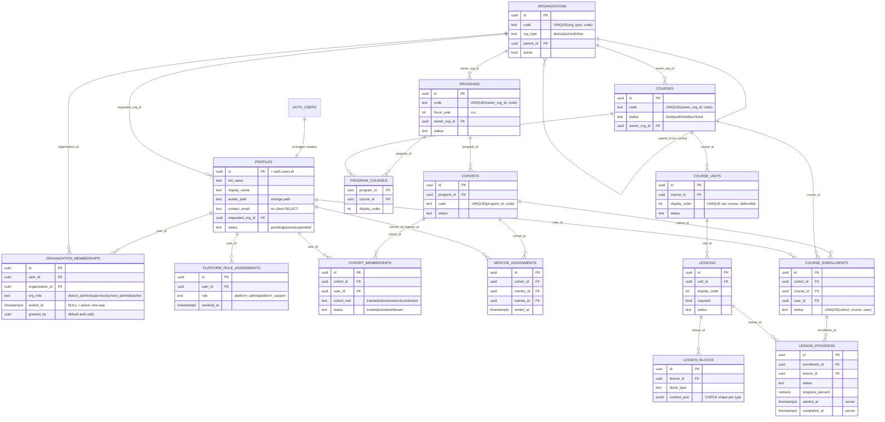

# ERD — Physical (Phase 1, ตาม Migration ที่สร้างจริง)

> ตารางของ Phase 2–4 (assessments, assignments, supervision) อยู่ใน `BLUEPRINT.md` §6 — จะเพิ่มเมื่อเขียน Migration จริง
> รายละเอียดคอลัมน์/constraint/index: `DATA_DICTIONARY.md` (สร้างอัตโนมัติจากฐานข้อมูล)

## นโยบาย ON DELETE

| ความสัมพันธ์ | นโยบาย | เหตุผล |
|---|---|---|
| `auth.users → profiles` | CASCADE | ลบบัญชี Auth = ลบโปรไฟล์ (ต้องมี retention policy ก่อนใช้จริง) |
| `organizations`, `programs`, `cohorts`, `courses` เมื่อถูกอ้างอิง | RESTRICT | ป้องกันหลักฐานการอบรม/ประวัติหาย — ใช้ `status = archived` แทน |
| `courses → course_units → lessons → lesson_blocks` | CASCADE | เนื้อหาเป็นของหลักสูตร |
| `lessons`/`course_enrollments` ที่มี `lesson_progress` | RESTRICT | การลบบทเรียนที่มีผู้เรียนแล้วจะล้มเหลว → บังคับ archive |
| `granted_by`, `created_by`, `enrolled_by` | SET NULL | เก็บแถวไว้แม้ผู้ดำเนินการถูกลบ |
